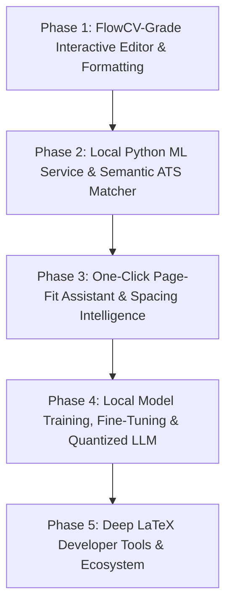

# Resume Studio — Engineering & Product Roadmap

## 1. Product Vision & Non-Negotiable Core Principles

**Resume Studio** is a private, local-first personal resume and CV development environment for Windows. Inspired by the clean typography and spatial balance of FlowCV, it provides complete control over structured resume data, typography, visual hierarchy, variant branching, and local PDF compilation.

### Core Non-Negotiables
- **100% Local-First & Private**: User resume data, contact information, photos, and job descriptions never leave the local machine. Zero mandatory login, zero third-party telemetry, zero external cloud subscriptions, and zero paid API dependencies.
- **Local TeX Live `pdflatex` Compilation**: All production PDF exports and preview renders are generated by the locally installed TeX Live `pdflatex` engine via a secure Node.js runtime process (`spawn` with `shell: false`, `-no-shell-escape`, isolated temporary workspaces, and strict escaping).
- **Zero Silent Content Loss**: Content belongs to the user. The app will never silently delete, truncate, drop, or rewrite text to force a page count. Any layout adjustment or fit recommendation requires explicit user preview and approval.
- **Data & Presentation Separation**: Single canonical content library with independent, versioned variants. Variants reference entries by stable IDs and maintain non-destructive overrides.
- **Resilient Multi-Runtime Architecture**: The primary application (Next.js 16 + Node.js) functions completely standalone without external dependencies. Advanced ML features run through an optional local Python microservice on loopback (`127.0.0.1`), with automatic graceful degradation when the Python runtime is not active.

---

## 2. System Architecture

```
+-----------------------------------------------------------------------------------+
|                                 USER BROWSER                                      |
|  - FlowCV-Inspired Split Workspace (Collapsible Sidebar, Editor, PDF.js Preview)  |
|  - IndexedDB Persistence (Local Drafts, Master Library, Visual Settings, Photos)  |
|  - Client-Side State: React 19, TypeScript, Vanilla CSS + Tailwind v4 Design Sys  |
+------------------------------------------+----------------------------------------+
                                           |
                    HTTP / JSON on 127.0.0.1:3000 (Loopback Only)
                                           |
+------------------------------------------v----------------------------------------+
|                         NEXT.JS APP ROUTER (Node.js Runtime)                      |
|                                                                                   |
|  [Route: /api/compile]                                                            |
|  - Input Validation & Schema Guard (Zod)                                          |
|  - LaTeX Escaper & Link Sanitizer                                                 |
|  - Isolated Per-Request Temp Directory Manager                                    |
|  - Spawn: pdflatex -interaction=nonstopmode -halt-on-error -no-shell-escape       |
|  - Process Timeout & Safe Diagnostic Log Redaction                                |
|  - Output PDF Byte Verification & Fast HTTP 200 JSON Payload Transfer             |
|                                                                                   |
|  [Route: /api/export-tex] (Phase 4)                                               |
|  - Packages standalone .tex source + validated assets into a downloadable .zip    |
+------------------------------------------+----------------------------------------+
                                           |
                 Optional Internal IPC / HTTP on 127.0.0.1:8000
                                           |
+------------------------------------------v----------------------------------------+
|               LOCAL PYTHON ML MICROSERVICE (FastAPI / PyTorch / spaCy)             |
|                                                                                   |
|  - 100% Offline, runs locally on user's machine (CPU or CUDA/DirectML)           |
|  - Semantic Matcher: sentence-transformers (all-MiniLM-L6-v2 / bge-small-en)      |
|  - Entity & Skill Extraction: spaCy NER pipeline (custom resume skill taxonomy)   |
|  - ATS Parsing Simulator: Emulates enterprise ATS parsing graphs & date formats  |
|  - Action-Verb & Impact Scorer: XYZ formula analysis & local bullet enhancement   |
|  - Optional Local LLM/SLM: llama-cpp-python (quantized Qwen2.5/Llama-3.2 1B/3B)   |
+-----------------------------------------------------------------------------------+
```

---

## 3. Current Implementation Status (Completed)

- [x] **Local `pdflatex` Engine**: Secure Node runtime spawn pipeline with timeout, argument validation, and per-compile temp directory isolation.
- [x] **5 Distinct LaTeX Templates**:
  - `t01-simple-ats`: Primary FlowCV-like clean, compact one-page software developer resume.
  - `t02-clean-compact`: Left-aligned dense layout for concise project-heavy applications.
  - `t03-modern-developer`: Modern single-column layout with restrained accent palette.
  - `t04-academic-cv`: Multi-page, text-first academic/research CV (supporting 2–3 pages).
  - `t05-profile-cv`: Professional CV with optional balanced portrait header.
- [x] **FlowCV-Inspired Sidebar UI**: Collapsible sidebar housing Brand, live autosave indicator (`● Saved locally`), document library, inline rename, variant duplication (`⧉`), and delete.
- [x] **Draft Creation Workflow**: Modal to instantiate either a **1-Page Developer Resume** (targeting `Md.Atikur_Rahaman_Full_Stack_Dev.pdf`) or a **2-Page Academic CV** (targeting `Md.Atikur-Rahaman-CV.pdf`).
- [x] **High-Density 15.6" Laptop Optimization**: 100vh fluid workspace, removal of top navigation bar to reclaim vertical viewport height (650–750px), custom dark-mode Chromium dropdown contrast styling.
- [x] **Real-Time PDF Preview**: Client-side PDF.js rendering with zoom, page navigation, and side-by-side **Two-Page Spread View** for multi-page CVs.
- [x] **Design Customizer**: 6 curated color palettes, 7 TeX Live font families, granular margin and divider controls, presentation presets.
- [x] **Phase 1: FlowCV-Grade Interactive Editor & Formatting**:
  - Section drag-and-drop reordering & keyboard shortcuts.
  - Markdown inline formatting in bullets (`**bold**`, `*italic*`, `[link](url)`) safely escaped into LaTeX macros.
  - Header layout architecture switcher (Centered Minimalist, Modern Left-Aligned, Split Two-Column Header).
  - Granular divider styles (Solid Hairline, Accent Tinted Bar, Dotted / Dashed, Clean Whitespace).
- [x] **Phase 2: Local Python ML Service & Semantic ATS Matcher**:
  - 100% offline companion microservice on loopback (`http://127.0.0.1:8000/health`) with automatic graceful fallback.
  - Semantic JD matcher with cosine similarity and keyword gap categorization (matched, partial, missing skills).
  - Google XYZ bullet scoring (action verb strength, metric detection, methodology).
  - Simulated ATS parsing diagnostic checking structured data extraction.
- [x] **Phase 3: One-Click Page-Fit Assistant & Spacing Intelligence**:
  - Deterministic spacing tightening optimizer with strict typographic safety bounds (minimum 9.0pt font, 13mm margins).
  - Interactive Page-Fit modal showing side-by-side parametric diffs and reclaimed vertical height percentage.
  - Page-balancing expansion strategy for underfilled documents.
  - Orphan Hunter detecting runaway single-word wraps with 1-click wordy filler trimmer.
  - Multi-page CV section break controls (`\clearpage\noindent `) in section customization drawer.
- [x] **Phase 4: Local Quantized Model / SLM Assist & Fine-Tuned Resume NER**:
  - Integration with user's local `qwen3.5:4b` running on GPU via Ollama (`127.0.0.1:11434`) with zero cloud keys.
  - Interactive bullet polish modal generating 3 high-impact variations (Quantified Impact, Action-First Leadership, Compact ATS).
  - Before/after Google XYZ impact scores with delta badges and zero silent content loss.
  - Custom NER fine-tuning and benchmark dataset generator (`train_ner.py`) with precision/recall evaluation.
  - Categorized skill entity extraction API (`/api/extract-entities`).
  - Seamless offline fallback when Ollama or Python service is inactive.
- [x] **Phase 5: Deep LaTeX Developer Tools & Local Ecosystem**:
  - Live LaTeX source inspector with line numbers, search filter, and instant copy/download (`.tex`).
  - Side-by-side LaTeX diff viewer highlighting dynamic line additions (`+`) and deletions (`-`) across templates and presets.
  - Standalone LaTeX ZIP package exporter (`/api/export-tex`) bundling `main.tex`, `resume-data.json`, `README.md`, and local portrait assets for instant compilation in TeX Live, MiKTeX, or Overleaf.
  - Local Snapshot Time Machine with IndexedDB v2 durable storage for creating named checkpoints, previewing, restoring, and forking variants.
  - ISO 19005-1 / PDF/A archival metadata injection switch for enterprise compliance and long-term digital preservation.
- [x] **Comprehensive Test Suite**: 45 automated Node/TypeScript test cases covering LaTeX generation, escaping, page-fit optimization, orphan detection, Phase 5 ZIP/diff/archival tools, and 6 Python ML tests (100% passing).

---

## 4. Phase-by-Phase Development Plan



---

### Phase 1: FlowCV-Grade Interactive Editor & Formatting Ergonomics
*Goal: Provide a tactile, zero-friction editing experience with intuitive ordering, rich typography formatting, and header customization.*

#### 1.1 Drag-and-Drop Reordering (Sections & Entries)
- **UI/UX**:
  - Replace `↑` / `↓` button clicks with smooth, physics-informed drag handles using `@hello-pangea/dnd` or native HTML5 drag.
  - Section reordering (e.g. moving *Projects* above *Experience*, or *Skills* below *Education*) with real-time drop-target indicators.
  - Entry reordering inside sections (e.g. reordering jobs or degrees) with smooth transition animations.
  - Keyboard accessible: <kbd>Space</kbd> to pick up, <kbd>↑</kbd>/<kbd>↓</kbd> to move, <kbd>Enter</kbd> to drop.
- **Data Layer**:
  - Update variant-specific `sectionOrder` and `entryOrder` arrays non-destructively in IndexedDB.

#### 1.2 Inline Rich Formatting in Bullets
- **Feature**:
  - Allow writing standard Markdown inside bullet points:
    - Bold: `**React**` or `**reduced latency by 45%**`
    - Italic: `*Summa Cum Laude*`
    - Links: `[Live Demo](https://example.com)`
- **LaTeX Safe Translation**:
  - Safe preprocessing pipeline converting Markdown syntax into pure LaTeX macros:
    - `**text**` → `\textbf{text}`
    - `*text*` → `\textit{text}`
    - `[label](url)` → `\href{sanitized_url}{\underline{label}}`
  - Strict escaping of user text before wrapping in LaTeX commands to prevent injection.

#### 1.3 Header Layout Switcher & Section Divider Styles
- **UI/UX**:
  - Visual selector in the **Design** tab for 3 primary header architectures:
    1. **Centered Minimalist**: Classic FlowCV look (Name, title, centered contact row with icons).
    2. **Modern Left-Aligned**: Name/title on left, contact chips stacked or right-aligned.
    3. **Split Two-Column Header**: Left column for identity, right column for GitHub, LinkedIn, Portfolio, and Phone.
  - Section divider styles:
    - *Hairline Solid* (default 0.6pt).
    - *Accent Tinted Bar* (uses the active theme accent color).
    - *Dotted / Dashed Accent*.
    - *Clean Whitespace* (no line; relying purely on typographic hierarchy).

#### 1.4 Local Profile Photo Cropper & Mask Tool (Template 05)
- **UI/UX**:
  - In-browser interactive canvas cropper for `t05-profile-cv`.
  - Supports zoom, pan, and circular / rounded-square mask preview.
  - Automated client-side format conversion to standard PNG/JPEG (eliminates unsupported WebP inputs before compile).

---

### Phase 2: Local Python ML Backend & Semantic ATS Matching
*Goal: Build a dedicated, 100% offline Python machine learning service that evaluates resume relevance against real job descriptions without sending any data to external servers.*

#### 2.1 Python ML Microservice Architecture
- **Technology Stack**:
  - **Framework**: FastAPI + Uvicorn bound strictly to `127.0.0.1:8000`.
  - **Embeddings**: `sentence-transformers` running lightweight, high-performance models (`all-MiniLM-L6-v2` or `bge-small-en-v1.5`, ~80MB footprint, fast CPU inference).
  - **Entity Extraction**: `spaCy` (`en_core_web_sm` / `en_core_web_md`) enhanced with a curated open-source tech-skills taxonomy.
  - **Execution**: Managed as a local background companion service or launched on-demand via a simple start script (`run-ml.bat` / `run-ml.sh`).
- **Resilient Fallback**:
  - The Next.js web application pings `http://127.0.0.1:8000/health`. If offline, the UI displays a clean status indicator (*"ML Engine: Idle / Offline"*) and all core editing/LaTeX compilation works with zero degradation.

#### 2.2 Semantic Job Description Matcher
- **UI/UX**:
  - **ATS Studio Drawer**: A slide-over panel where the user pastes the raw text of a target Job Description.
  - **Semantic Match Gauge**: Visual match percentage (0–100%) calculated via cosine similarity between resume bullet vectors and JD requirement vectors.
  - **Keyword & Skill Categorization**:
    - *Matched Core Skills* (green tags): E.g., `TypeScript`, `Next.js`, `Docker`, `PostgreSQL`.
    - *Partially Related Competencies* (amber tags): E.g., JD asks for `Kubernetes`, resume mentions `Containerization/Docker`.
    - *Missing High-Frequency Keywords* (red outline tags): Critical JD requirements absent from the resume.

#### 2.3 Simulated ATS Parser & Validation Diagnostic
- **Feature**:
  - Runs a parsing simulation emulating popular applicant tracking systems (Greenhouse, Lever, Workday).
  - Tests whether the compiled PDF yields clean, structured plaintext in correct reading order:
    - Does the parser cleanly separate Job Title from Company Name?
    - Are start/end dates parsed into standard ISO dates?
    - Are contact phone numbers and email addresses unambiguously extracted?
  - Highlights potential ATS parsing traps (e.g. multi-column text collision, unparseable date formats).

#### 2.4 Bullet Impact & Quantification Scorer (Google XYZ Rule)
- **NLP Analysis**:
  - Analyzes every bullet point against the Google XYZ formula: *"Accomplished [X] as measured by [Y], by doing [Z]"*.
  - **Verb Strength Classifier**: Flags weak passive verbs (*"Assisted with"*, *"Responsible for"*, *"Worked on"*) and suggests high-impact alternatives (*"Architected"*, *"Optimized"*, *"Pioneered"*).
  - **Metric Detection**: Flags bullets that lack measurable impact metrics (percentages, latency reductions, user volume, dollar savings).

---

### Phase 3: One-Click Page-Fit Assistant & Spacing Intelligence
*Goal: Solve the classic resume overflow problem (spilling 2–4 lines onto an unwanted next page) through deterministic, mathematical micro-adjustments with strict user consent.*

#### 3.1 Page Budget Gauge & Real-Time Overflow Telemetry
- **Feature**:
  - Inspects the compiled PDF page count and vertical content height.
  - Displays a subtle **Page Fullness Meter** in the preview toolbar:
    - `92% Page 1`: Healthy, balanced one-page resume.
    - `100% Page 1`: Perfectly filled single page.
    - `104% (Page 2 Overflow — 3 lines)`: Actionable warning banner.

#### 3.2 The "Fit to Exactly 1 Page" Assistant (Mathematical Micro-Tuner)
- **Constraint**: *Strictly preserves our non-negotiable rule: Never silently shrink or cut content.*
- **Algorithm & Bounds**:
  - When a document spills onto Page 2 by $\le 6$ lines, the user can click **"Fit to 1 Page Assistant"**.
  - The assistant calculates safe, proportional micro-adjustments within strictly validated typographic bounds:
    - Section bottom margin: `8pt → 6.5pt`
    - Entry item separation: `4pt → 3pt`
    - Page top/bottom margins: `18mm → 16mm`
    - Line stretch / font size: `10pt → 9.5pt`
- **Interactive Diff Modal**:
  - Shows the user the exact proposed changes in a clear side-by-side comparison.
  - Compiles a draft preview so the user sees the visual balance before clicking **"Apply Adjustments"** or **"Keep As Is"**.

---

### Phase 4: Local Model Training, Fine-Tuning & Quantized LLM Assist
*Goal: Provide privacy-preserving, local AI assistance for bullet point refinement and custom skill entity recognition without relying on paid commercial APIs.*

#### 4.1 Custom Resume Entity Recognition (NER) Fine-Tuning Pipeline
- **Dataset & Pipeline**:
  - Python training script using Hugging Face `transformers` or `spaCy` to fine-tune a small NER model on open-source resume corpus data (e.g., tech skills, certifications, job titles).
  - Enables Resume Studio to identify domain-specific technologies and developer tools that generic language models miss.

#### 4.2 Local Quantized LLM Inference (Offline Bullet Polishing)
- **Technology**:
  - Integration with `llama-cpp-python` or local `Ollama` endpoint running small, ultra-fast quantized models:
    - `Llama-3.2-1B-Instruct-GGUF` (fast, low memory footprint ~1.2GB VRAM/RAM).
    - `Qwen2.5-1.5B-Instruct-GGUF` (exceptional coding and technical reasoning).
- **User-Controlled UX Flow**:
  - User selects a bullet point and clicks **"Suggest Stronger Phrasing"**.
  - Local model returns 3 distinct variations:
    1. *Quantified Impact Variation* (emphasizing metrics and scale).
    2. *Action-First Variation* (emphasizing technical leadership and execution).
    3. *Compact ATS Variation* (densely packed with relevant keywords).
  - User can click **"Insert"**, **"Edit"**, or **"Dismiss"**. No automatic text replacement is ever permitted.

---

### Phase 5: Deep LaTeX Developer Tools & Local Ecosystem
*Goal: Empower power users and LaTeX enthusiasts with total transparency, inspection tools, and portable backups.*

#### 5.1 Live LaTeX Source Inspector & Diff Viewer
- **UI/UX**:
  - A slide-over code drawer displaying the exact `.tex` markup generated for the active variant.
  - Real-time syntax highlighting with copy-to-clipboard.
  - **Live LaTeX Diff**: Shows line-by-line diffs (`+` / `-`) when switching between templates or modifying design presets.

#### 5.2 Standalone LaTeX ZIP Bundle Export
- **Feature**:
  - **"Export LaTeX Package (.zip)"** button.
  - Produces an archive containing:
    - `main.tex`: Complete, standalone document that compiles cleanly in any standard TeX Live / Overleaf environment.
    - `/assets`: Local images, fonts, or icons referenced in the document.
    - `resume-data.json`: Versioned backup of the structured resume content.

#### 5.3 Local Snapshot History ("Time Machine")
- **Feature**:
  - Named local checkpoints stored in IndexedDB:
    - E.g. *"Baseline Full-Stack Draft"*, *"Tailored for Google SRE"*, *"Post-Review with Mentor"*.
  - One-click rollback to any historical snapshot or fork into a new variant.

#### 5.4 PDF/A Archival & Accessibility Compliance
- **Feature**:
  - Support compiling with `pdfx` or `pdfmanagement-testphase` for **PDF/A-1b / PDF/A-2b** compliance.
  - Ensures long-term digital preservation and flawless readability for automated enterprise document archival systems.

---

## 5. UI/UX Design System & Ergonomics Standards

### 5.1 Visual Style & Palette Tokens
- **Backgrounds**: Deep, rich dark theme (`#0b0f0d` root, `#131a15` sidebar/cards, `#1c2620` hover/subtle borders).
- **Accents**: Curated, harmonious colors with high contrast:
  - *Forest Emerald*: `#10b981` (Primary system accent).
  - *Classic Navy*: `#3b82f6`
  - *Slate Executive*: `#64748b`
  - *Academic Crimson*: `#e11d48`
  - *Developer Teal*: `#14b8a6`
  - *Monochrome ATS*: `#27272a`
- **Typography**: Inter / DM Sans for application interface; standard Latin Modern / TeX Gyre / Computer Modern for compiled LaTeX output.

### 5.2 15.6" Laptop Workspace Optimization
- **Viewport Constraints**: Desktop laptop displays typically provide $1366 \times 768$ to $1920 \times 1080$ resolution, with usable browser viewport height ranging from **650px to 750px**.
- **Design Guidelines**:
  - Zero wasted vertical space: All navigation and draft switching resides in the collapsible left sidebar.
  - Sticky section quick-nav chips (`[ 👤 Profile ] [ ⚡ Skills ] [ 💼 Experience ]`) allow instant jumping across long forms without manual scrolling.
  - Dual independent scroll containers: Editor and PDF Canvas scroll independently with synchronized heights.

### 5.3 Multi-Page Document Inspection
- **Two-Page Spread View**: Side-by-side Page 1 and Page 2 rendering for 2+ page CVs (such as `t04-academic-cv` targeting `Md.Atikur-Rahaman-CV.pdf`).
- Enables immediate evaluation of visual density, whitespace balance, and page-break placement without vertical scrolling.

---

## 6. Testing & Quality Assurance Gates

Every feature must pass the following validation criteria prior to delivery:

1. **Automated Unit & Integration Checks**:
   - `npm run typecheck`: Strict TypeScript, 0 errors.
   - `npm run lint`: ESLint with React 19 rules, 0 errors, 0 warnings.
   - `npm test`: Automated Vitest test suite executing local `pdflatex` compilation across all templates.
2. **LaTeX Escaping & Injection Rigor**:
   - Automated tests verifying correct handling of special characters: `\`, `{`, `}`, `$`, `&`, `%`, `#`, `_`, `~`, `^`, angle brackets, and Unicode punctuation.
   - Hyperlink sanitization ensuring only valid `http://`, `https://`, and `mailto:` protocols are compiled.
3. **Synthetic Fixture Rule**:
   - Never commit private personal data (real phone numbers, personal email, home address, personal photos) into the repository or tests.
   - All tests and screenshots must utilize synthetic fixtures.
4. **Offline Resilience**:
   - The application must remain fully functional when the network is disconnected and when the optional Python ML backend is offline.
